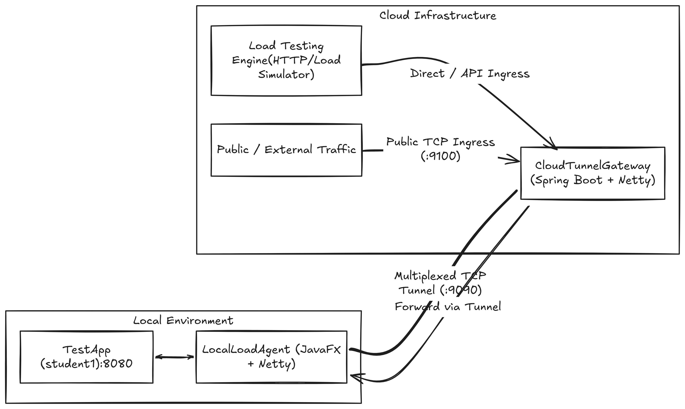

# LoadMeter Services

This directory contains the core services and components powering the **LoadMeter** platform — a distributed load testing and cloud tunneling system designed to test locally hosted services securely without manual network forwarding.

---

## Architecture Overview



---

## Services & Modules

### 1. `cloudtunnelgateway`
* **Technology**: Java 17, Spring Boot 4.1.x, Netty 4.1.x
* **Description**: The cloud-hosted gateway and orchestration server.
* **Key Responsibilities**:
  * **Tunnel Gateway Server (`port 9090`)**: Listens for incoming connections from `LocalLoadAgent` instances, handles agent registration, multiplexes data frames, and manages tunnel heartbeats/sessions.
  * **Public TCP Ingress (`port 9100`)**: Accepts inbound external TCP/HTTP traffic and maps incoming client streams to the active registered local agent tunnel.
  * **Load Testing Engine (`port 8081`)**: RESTful APIs to trigger, orchestrate, monitor, and report asynchronous load test benchmarks.
* **Key Endpoints**:
  * `POST /api/load-tests` — Initiate an asynchronous load test run.
  * `GET /api/load-tests/{testId}` — Check real-time progress and job status (`PENDING`, `RUNNING`, `COMPLETED`, `FAILED`).
  * `GET /api/load-tests/{testId}/results` — Retrieve aggregated performance metrics (latency, throughput, success/failure counts).
  * `GET /tunnel-test/forward` — Test end-to-end tunnel connectivity forwarding.

---

### 2. `LocalLoadAgent`
* **Technology**: Java 21, JavaFX 21, Netty 4.1.x
* **Description**: A desktop client application run by developers in their local environment.
* **Key Responsibilities**:
  * **Secure Outbound Tunnel Client**: Connects outbound to the `CloudTunnelGateway` on port `9090`, avoiding NAT and firewall restrictions.
  * **Local Port Forwarding**: Receives multiplexed stream frames from the cloud gateway, unwraps them, and forwards the TCP/HTTP requests to the locally running target application (default `localhost:8080`).
  * **Desktop GUI**: Built with JavaFX to give developers simple controls to configure target application ports, connect/reconnect, and view live tunnel connection statuses.

---

### 3. `TestApp`
* **Technology**: Java 17, Spring Boot 4.1.x
* **Description**: Sample target microservices used for validation, integration tests, and benchmarking.
* **Modules**:
  * **`student1`**: A sample Spring Boot REST service running on `localhost:8080`, exposing endpoints such as `GET /api/users` and `POST /api/users` to simulate real-world web application behavior under load.

---

## Getting Started

### Prerequisites
* Java JDK 17 & Java JDK 21
* Maven 3.8+ (or included Maven wrappers `mvnw` / `mvnw.cmd`)

### Running Locally

#### 1. Start the Target Application (`TestApp`)
```bash
cd services/TestApp/student1
./mvnw spring-boot:run
```
*Accessible locally at `http://localhost:8080/api/users`.*

#### 2. Start the Cloud Tunnel Gateway
```bash
cd services/cloudtunnelgateway
./mvnw spring-boot:run
```
* *REST API*: `http://localhost:8081`
* *Agent Tunnel Port*: `9090`
* *Public Ingress Port*: `9100`

#### 3. Launch the Local Load Agent GUI
```bash
cd services/LocalLoadAgent
mvn javafx:run
```
1. Enter your local application port (e.g. `8080`).
2. Click **CONNECT** to establish the tunnel with the gateway.
